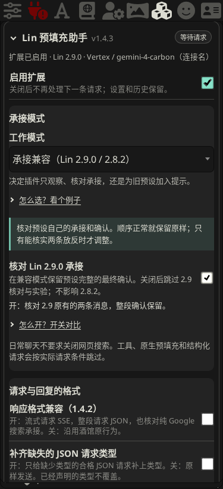

# Lin 预填充助手 v1.4.3

SillyTavern 前端扩展。继续使用原来的 Lin 预设、角色卡和世界书；安装时不导入 JSON，不需要油猴、酒馆助手或额外 API。它核对已组装请求里的承接和实际返回证据，不会把普通消息变成服务商未提供的原生预填充。

## 我该开什么？

Lin 2.9.0 日常使用：在 **扩展 → Lin 预填充助手** 打开扩展，选 **承接兼容**，勾选 **核对 Lin 2.9.0 承接**。可以照常开启 Google 网页搜索。升级时不替你更换旧选择；本版新增实验默认全关。

|面板选项|什么时候开？开了具体做什么？|关掉或不适用时|
|---|---|---|
|承接兼容 / 原样诊断|前者核对已启用、末尾唯一可识别的 Lin 承接，必要时仅调回整条原文的位置。后者用于查看未经本插件调整的请求。|无法证明归属就不移动；2.9.0 不采用 2.8.2 的短确认。|
|响应格式兼容（1.4.2）|如果开了流式，接入层却返回一次性 JSON，可以试开。流式请求声明接收 SSE、整段请求声明接收 JSON；纯 Google 搜索时也可核对尾部错序。|沿用原来的格式。开搜索无需关插件；已有工具历史、签名或不明结构另行跳过。|
|补齐缺失的 JSON 请求类型|仅当排查发现**出站没有声明 JSON** 时试开。只给已核对的酒馆 JSON 生成请求补请求类型；正常酒馆一般已经填好。|不碰已有声明，不修复令牌、内容过滤和正文长度。|
|回显保护 → 标准|如果开着旧格式标记或旧样本，上次**只原样返回了该标记**，并且接口明确报告正常停写，你主动重生成或滑动同一题时，这一次不再附上它。|关掉则继续按旧设置发送。没有旧辅助区、没有结束原因、普通空回、拒答或续写都不触发。不必为了用它而打开旧标记。|
|追踪本轮回包（独立随机锚）|排查请求对应关系时开：合格请求带一个发给酒馆的一次性编号。对方也回传该头才能比对；默认酒馆常常不回传。|不发编号。开关均不改模型提示词；无回传不代表丢包。|
|显示本版诊断|想知道“本轮到底改了什么”就开。显示上述各项分别是发送、跳过、回退，还是未观察到；可复制脱敏统计。|只收起详情，不改「记录发送和返回」、被动保留或承接。|
|范围 / 注入方式 / 思考预算|在「承接与旧版预设」可点整行：决定旧版增强的适用范围、一条还是两条消息、是否保留原预算。|选项可先保存；当前是 2.9.0 或原样诊断时，不会把旧版增强强套上去。|
|旧样本编号、旧格式标识、被动保留|在「样本与旧格式对照」保留原用法。旧样本和旧格式标记都会进入可识别的独立模型辅助区；被动保留只供手动复制已经完整收到的文本。|深度护盾未开放；旧格式的 JSON 写法不等于深度护盾。|
|检查当前回复 / 手动补全、重生成|在「诊断与补全」先免费核对当前回复。只有自己点补全或重生成才可能发起新的模型调用。|不能恢复服务端从未发出的文字。补全是续写，重生成是替换当前候选。|

就算结束原因为 STOP，也不证明故事写完。若回包报告内容过滤，按过滤显示；若只收到结束帧、超限、工具结果或接口不交代原因，则分别显示。不会因这些状态自动重试。

[查看手机上的回显保护选项和本轮结果](docs/images/v143/guard-modes.png)

## 暂停、恢复默认与回退

- **暂停本版新实验**只切换暂停键。点击「恢复运行」会恢复你上次的选择。旧承接、旧样本、响应格式和历史照常使用。
- **恢复本版新实验默认值**关闭本版回显保护、追踪号、请求类型修复和新详情，长度恢复为短，并解除暂停。
- 折叠区原有的「恢复新实验推荐设置」是 **1.4.2** 的操作；旧「关闭全部新实验」仍会同时关闭旧格式、旧样本、被动保留及旧响应格式兼容。它们不会改上面的新开关。

**安装 ZIP：**把已有的 `lin-prefill-guard` 文件夹备份到扩展扫描目录**之外**，再用 ZIP 内同名文件夹整体替换。常见账户路径是 `SillyTavern/data/<账户>/extensions/lin-prefill-guard/`；安装为所有用户时是 `SillyTavern/public/scripts/extensions/third-party/lin-prefill-guard/`。沿用原安装位置，只留一个副本。确认目录内直接有 `manifest.json`，刷新酒馆后面板应显示 **v1.4.3**。用手机连接远端酒馆，需要在运行酒馆的服务器上替换。ZIP 不是预设导入文件。

**退回 1.4.2：**结束当前生成，移出 1.4.3 目录，把原备份放回原路径并刷新。两版使用相同设置与历史键，旧版忽略新增字段；不需要清空账户、预设或聊天。

源码、测试、[机制与兼容边界](docs/MECHANISMS-1.4.3.md)、[八轮验收记录](docs/VALIDATION-1.4.3.md)、[逐文件变更](docs/CHANGES-1.4.3.md)都在包内。真实云端模型生成、物理 iPhone/VoiceOver、TauriTavern 与长期文学质量没有实机结论。

## 文档导航

[完整文档目录](docs/README.md)：当前说明、机制、兼容范围、验证记录与历史资料。
