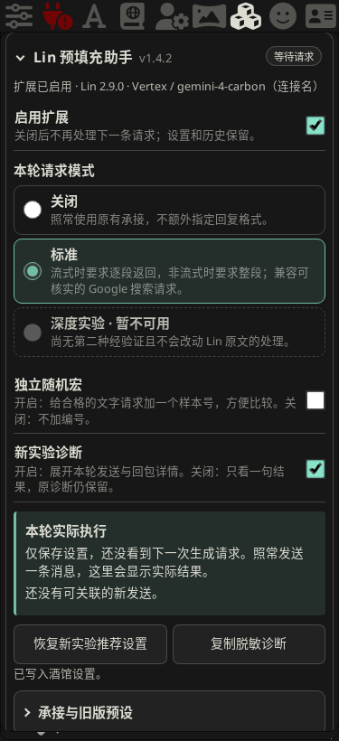

# Lin 预填充助手 v1.4.2

这是可独立安装的 SillyTavern 前端扩展。直接沿用原来的 Lin 预设、角色卡和世界书。无需导入 JSON、油猴或新的 API 密钥。插件在有限条件下核对承接原文的位置；不能创造服务商的原生预填充，也不能取回模型没有生成的正文。

## 从这里开始

打开 **扩展 → Lin 预填充助手**。主面板只有一列，直接点整行即可选择。用 Lin 2.9.0 时，打开「启用扩展」，在下方「承接与旧版预设」选「承接兼容」，并勾选「核对 Lin 2.9.0 承接」。从旧版升级不会替你切换选择。**日常聊天可以保留 Google 网页搜索。**

|我想做什么|点哪里|下一条请求会怎样|
|---|---|---|
|照常使用以前的设置|本轮请求模式 → **关闭**（新安装默认）|原承接继续按原条件运行，不要求新的回复格式。以前单独开启的样本号或格式标记保留。|
|排查明明开了流式却收不到正文|点 **标准**，照常发一条消息|对已核实的 2.9.0 请求，流式明确要求逐段返回，非流式要求整段返回。接入层本来就返对格式时，未必能看到区别。已有明确接收格式不会被覆盖。|
|开着 Google 搜索，还要保留承接|同样选 **标准**；保留酒馆的网页搜索开关|在 Vertex / AI Studio 的纯搜索文字请求，仅在能核实末尾两条原文放反时调回；顺序正确就不动。搜索不加样本号。已有工具对话、签名或图片则跳过新实验。|
|给同一题的几种回复做对照|打开 **独立随机宏**，在「样本与旧格式对照」选触发时机|可以每次重抽、只给普通发送编号，或让同题滑动/重生成沿用已在浏览器提交的样本。认不出同一题就不复用。关闭不会影响预设自带的随机宏。|
|看这次到底做了什么|打开 **新实验诊断**，看「本轮实际执行」|区分设置已保存、已观察发送、回包、跳过或回退。此开关只改显示，不会影响「记录发送和返回」。|
|把结果发给别人排查|点 **复制脱敏诊断**；多次请求可在历史里选「导出脱敏统计」|只含固定类别、状态和计数。分享前不必手工清理提示原文。旧版完整历史导出还在独立的“完整历史备份”里，可能包含你的自定义提示。|
|修改旧预设的三项选择|展开 **承接与旧版预设**：范围、注入方式、思考预算都可以点整行|例如选择“两条”会先发助手承接、再发用户执行；在原样诊断或 Lin 2.9.0 中只保存该旧版偏好。|
|接口有文本，但聊天里显示不全|**诊断与补全** → 检查当前回复 / 复制原文；按需打开被动保留|只读取已保存或本轮完整返回的数据。手动补全、重生成是新的模型调用，必须由你点击。|
|撤销主面板实验|点 **恢复新实验推荐设置**|只把标准档、独立随机宏和新实验诊断关闭。保留承接模式、自定义文字、搜索、旧标记、格式偏好、被动保留和历史。|

**深度实验暂不可选。** 旧版的文本/JSON 标记都还在高级选项里，改变标记写法不代表多出一种有效的处理方式。主动工具输出通道也未接入聊天；现有被动复制不能续传截断文本。

## 安装与回退

1. 先把原插件目录复制到扩展目录**之外**作备份。服务器上运行的酒馆，需要在服务器上操作。
2. 解压安装 ZIP，用其中的 `lin-prefill-guard/` 替换原同名目录；不要同时启用两份。账户扩展常见位置是 `SillyTavern/data/<账户>/extensions/`；全局安装沿用原 `public/scripts/extensions/third-party/`。插件目录里应能直接看到 `manifest.json` 和 `index.js`。不需运行 npm。
3. 刷新酒馆，面板标题应显示 **v1.4.2**。手机若仍显示旧版，重新加载页面；确认当前账户只有一份插件。
4. 想回退：移走 1.4.2 目录，将备份的 1.4.1 目录放回原位置，再刷新。无需清空账户设置、聊天或预设。两版共用既有设置键；旧版会忽略新键。新增的同题复用偏好在 1.4.1 中按其旧默认触发逻辑解释，想恢复原先的具体触发方式可在旧设置中选择。

## 证据与限制

- 真实酒馆前后端、Chromium 与本地受控回包的对照见 [验收报告](docs/VALIDATION-1.4.2.md) 和 [实际出站差异](evidence/v142/real-142.json)。报告把浏览器请求、酒馆的 Google 协议转换和真实云模型验证分开。
- [三档能力与字段](docs/MODES-1.4.2.md)、[逐文件改动和兼容差异](docs/CHANGES-1.4.2.md)、[版本历史](CHANGELOG.md)。
- 不调整原预设采样、输出预算、隐藏思考或搜索权限。旧 2.8.2 Vertex 正文承接、旧版思考/上限开关仍在原条件下按原设定工作。
- 对 Argon、Carbon、Hydrogen、Neon 只识别受支持的连接标签；不是实际模型身份证明。本地测试未使用真实 Google 账户，未验证路由、审核、长期截断率或文学质量。需要工具签名、显式请求正文密码、未知协议或变形的请求会保守处理；详见报告。

## 文档导航

[查看完整文档目录](docs/README.md)：当前版本说明、兼容矩阵、验证记录与历史资料。
